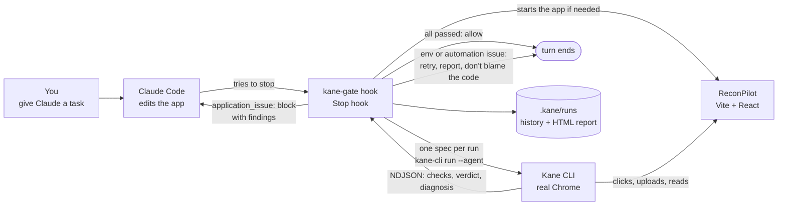
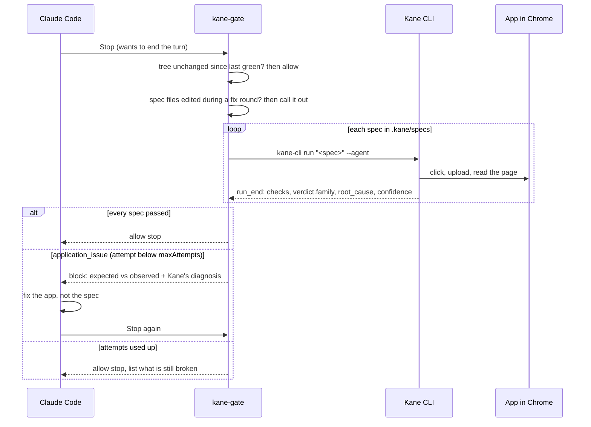
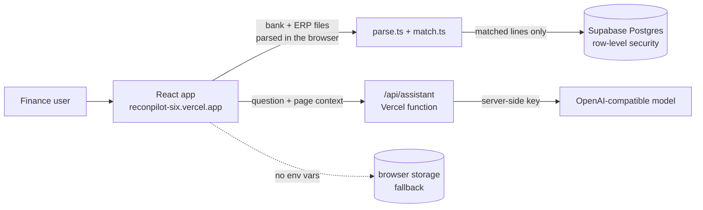
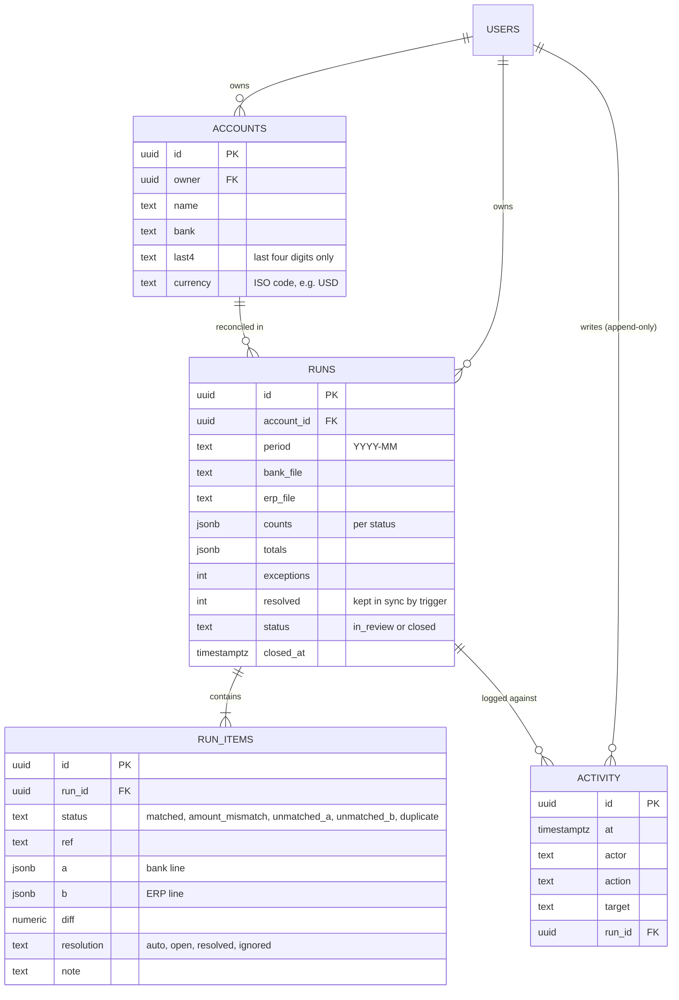

# kane-gate

AI coding agents love to say "done" before anything has been checked. kane-gate makes Claude Code prove it first.

It's a Claude Code Stop hook. When Claude tries to end its turn, kane-gate runs your specs through [Kane CLI](https://www.testmuai.com/support/docs/kane-cli-introduction) in a real Chrome. If a spec fails, Claude isn't allowed to stop. It gets Kane's findings instead: what was expected, what the page actually showed, and Kane's own read on the cause. It keeps going until everything passes.

Live demo app: **https://reconpilot-six.vercel.app**

## What it looks like in practice

We gave a fresh, headless Claude Code session a small, unrelated job: add a "Copy reference" button to a panel in the demo app. What it didn't know is that an earlier commit had broken the bank-file parser in a way the unit tests didn't catch.

Claude added the button, wrote a spec for it, ran the tests, and was ready to stop:

> I added a "Copy reference" button next to the reference heading in the line detail panel. Unit tests pass (3 of 3) and the type check is clean.

The Stop hook ran Kane. The button passed. The two parser specs didn't, and this is what Claude got back instead of being allowed to stop (trimmed):

```
kane-gate: Kane CLI tested your change in a real browser and 2 of 3 spec(s) FAILED.
You are not done yet (verification attempt 1/3).

✗ Reconcile sample files — summary counts
  Check "Matched is 39": expected "39", observed "0"
  Check "Amount mismatch is 3": expected "3", observed "34"
  Kane's diagnosis (application_issue, confidence 0.97): "The loaded bank sample appears to
  have been read with the wrong number format. For example, values using a period for
  thousands and a comma for decimals are treated as very small amounts..."

✗ Amount mismatch row shows correct dates and difference
  Check "...Difference $50.00": expected "$50.00", observed "$91,625.00"
```

Claude's reply:

> The copy-reference check passed. The two failing checks are about bank-file parsing, which my change didn't touch. The latest commit is the likely cause, so I'll look at it.

It found the three bugs, fixed them, added regression tests, and stopped again. Kane re-ran and passed 3/3. The whole session took 33 turns and about 15 minutes.

- Full transcript and the gate's log: [`docs/loop-demo/run2-readable.txt`](docs/loop-demo/run2-readable.txt), [`run2-kane-gate-live.log`](docs/loop-demo/run2-kane-gate-live.log)
- The code Claude wrote is on the [`demo-loop`](../../tree/demo-loop) branch, as its own commit.

In an earlier run Claude noticed the broken parser on its own from the git history, but stopped to ask instead of fixing it. The hook turned that into a fix as well ([`run1-readable.txt`](docs/loop-demo/run1-readable.txt)).

## Setup

You need Kane CLI and a TestMu account:

```bash
npm install -g @testmuai/kane-cli
kane-cli login
```

Then, in your project:

```bash
npx kane-gate init
```

That adds:

| File | What it's for |
| --- | --- |
| `kane-gate.config.json` | app URL, how to start the app, how many fix rounds to allow |
| `.kane/specs/*.md` | your specs, one user flow per file |
| `.claude/settings.json` | the Stop hook |
| `CLAUDE.md` | tells Claude to write a spec before the code, and to fix the app rather than the spec |

A spec is a short markdown file:

```md
---
name: Reconcile sample files — summary counts
url: /
---
Click "Try the live demo", then "New reconciliation".
Click "Load sample data", then "Reconcile".
Verify the summary cards show Matched 39, Amount mismatch 3, Only in Bank 2, Only in ERP 3 and Duplicate 2.
```

## How it works

1. Claude finishes a turn and Claude Code calls `kane-gate hook`.
2. kane-gate checks the app is running and starts it if it isn't.
3. Each spec goes through `kane-cli run --agent`.
4. If everything passes, Claude can stop.
5. If something fails, the hook blocks the stop and hands Claude the failures, including Kane's diagnosis and suggested next step.
6. After a few rounds (`maxAttempts`) it gives up, lets Claude stop, and tells you what's still broken.

Things that keep it from getting in the way:

- **It trusts Kane's triage.** Kane classifies each failure. Only an `application_issue` blocks Claude. If Kane says the problem was the environment or its own automation, Claude isn't sent chasing a bug that isn't there.
- Browser hiccups like `TargetClosedError` are retried once and never reported as app bugs.
- If nothing changed since the last green run, Kane doesn't run again, so no credits are wasted.
- If Claude edits a spec while it's supposed to be fixing the code, kane-gate calls it out.
- Text from the page is treated as data. A page can't sneak instructions into Claude's prompt.
- If kane-gate itself crashes, Claude can still stop.

## Why it has to be Kane

The bugs in the story above passed every unit test. They only show up when a real bank file goes through the real upload screen and someone reads the numbers on the page. That is what Kane does, and nothing else in the loop can.

- **It reads plain English.** A spec is what a finance person would check by hand. There are no selectors, so when Claude restyles a page there is nothing for it to "fix" in the test.
- **It uses the app.** Kane clicks, uploads and reads the screen in Chrome. The spec above clicks the same buttons a person would.
- **It explains what it saw.** Each failure comes back with expected and observed values, and with Kane's own verdict: `application_issue`, `environment_issue` or `automation_bug`, a root cause, a suggestion and a confidence. kane-gate forwards that to Claude, so it starts from "wrong number format, 0.97" instead of guessing.
- **It triages itself.** Only an `application_issue` blocks the agent. A flaky browser or a Kane hiccup is retried and reported to you, not dumped on Claude as a bug to chase.

## Architecture



### One blocked stop, step by step



### The app



### Data model

Every table carries `owner`, and row-level security limits every read and write to `auth.uid()`. The schema is [`apps/reconpilot/supabase/schema.sql`](apps/reconpilot/supabase/schema.sql).



### Who can do what

| | Can | Can't |
| --- | --- | --- |
| **Claude (coding agent)** | edit the app and its specs, read Kane's findings | end a turn while an `application_issue` is open, until `maxAttempts` runs out. Quietly edit a spec during a fix round: kane-gate points it out. |
| **kane-gate** | start the app, run Kane, block or allow the stop, keep history | edit code. If it crashes, it lets Claude stop rather than trapping the session. |
| **Kane CLI** | use the running app in Chrome and report what it saw | change anything. Page text it returns is treated as data, never as instructions to Claude. |
| **A ReconPilot user** | see and change their own workspace | read anyone else's rows (RLS), edit items in a closed period, edit or delete the activity log |

## What's real and what's staged

| Real | Staged |
| --- | --- |
| Both Claude Code sessions in [`docs/loop-demo/`](docs/loop-demo/): headless runs, transcripts and gate logs as they came out, including turns, time and cost | The three parser bugs were planted on purpose (`npm run demo:break`) so the story is repeatable. Claude wasn't told about them. |
| Every Kane result quoted here, and every row of [`docs/gate-history.md`](docs/gate-history.md) | The demo workspace data is seeded (Aug to Nov 2026) |
| `kane-gate` on npm, installable with `npx kane-gate init` | The sample bank files are realistic but made up |
| The live app, database, auth and assistant at reconpilot-six.vercel.app | |

## Proof

- 26 gate runs on this repo between 17 and 25 Nov: 9 from the Stop hook, the rest by hand. 79 spec runs passed, 5 failed and named the broken flow, 1 was a Kane login problem that kane-gate correctly didn't blame on the code. Full table: [`docs/gate-history.md`](docs/gate-history.md).
- The loop: [`run2-readable.txt`](docs/loop-demo/run2-readable.txt), blocked once, fixed, 3 of 3 green, 33 turns, about 15 minutes, $0.73.
- kane-gate's own tests: `npm test -w kane-gate`. The app's: `npm test -w reconpilot`.

| Spec | What Kane checks |
| --- | --- |
| [`demo-login`](.kane/specs/demo-login.md) | the landing page opens the live demo workspace |
| [`reconcile-summary`](.kane/specs/reconcile-summary.md) | the sample files give 39 matched, 3 mismatches, 2 only in bank, 3 only in ERP, 2 duplicates |
| [`mismatch-detail`](.kane/specs/mismatch-detail.md) | a mismatch row shows both dates and a $50.00 difference |
| [`bank-header-rows`](.kane/specs/bank-header-rows.md) | an internet-banking export with title rows and CR/DB amounts reconciles the same |
| [`bank-xlsx`](.kane/specs/bank-xlsx.md) | the Excel statement gives the same result as the CSV |
| [`resolve-exception`](.kane/specs/resolve-exception.md) | resolving an exception with a note moves review progress |
| [`assistant`](.kane/specs/assistant.md) | the assistant opens and answers about the current page |
| [`expired-email-link`](.kane/specs/expired-email-link.md) | an expired confirmation link explains itself and offers a new email |
| [`kane-section`](.kane/specs/kane-section.md) | the landing page shows this loop and its code |
| [`mascot`](.kane/specs/mascot.md) | the mascot answers when clicked |

## Commands

| Command | |
| --- | --- |
| `kane-gate init` | set up a project |
| `kane-gate run [spec…] [--headed]` | verify now; exits 1 on failure, so it works in CI too |
| `kane-gate watch` | live view of what Kane is doing |
| `kane-gate report --open` | HTML history of runs, failures caught and credits used |

## The demo app: ReconPilot

`apps/reconpilot` is what kane-gate guards in this repo. It's a bank-to-ERP reconciliation app built with React, Vite and Supabase, live at [reconpilot-six.vercel.app](https://reconpilot-six.vercel.app).

You upload a bank statement and an ERP ledger export, as CSV or Excel. ReconPilot matches the lines by reference and puts everything that doesn't match into a queue. You resolve each one with a note, and once nothing is open you close the period. Closed periods are locked by the database. There's also an overview dashboard, multiple bank accounts, an audit log, and an assistant that can see the page you're on.

"Try the live demo" logs you into a demo workspace with two bank accounts and three months of history.

Ten Kane specs cover it, from the landing page to resolving an exception and asking the assistant a question (list in [Proof](#proof)).

### Real bank files

Bank exports are messy, so the parser handles what they actually look like:

- `.xlsx` workbooks as well as CSV, including semicolon CSVs saved by Excel
- account info or title rows above the table
- separate Debit and Credit columns, and amounts like `1,625.00 CR` or `6.50 DB`
- references buried in the description ("TRF PT KENCANA MAS INV-1004")
- `1,625.00`, `1.625,00` and `$1,625.00`
- day/month vs month/day, worked out per file. When a file doesn't make it clear, the app says so and lets you switch.

`apps/reconpilot/public/samples` has the same transactions in three formats. All three must reconcile to the same numbers, and Kane checks that.

### Running it yourself

```bash
npm install
npm run dev          # http://localhost:5173
npm run gate         # all specs pass
```

Without Supabase settings the app keeps its data in the browser, which is enough to try everything. To use a real database:

1. Create a Supabase project and run [`apps/reconpilot/supabase/schema.sql`](apps/reconpilot/supabase/schema.sql) in the SQL editor.
2. Under Authentication → URL Configuration, set the Site URL to where the app runs, and add it to the redirect URLs.
3. Copy `apps/reconpilot/.env.example` to `.env.local` and fill in the URL, the publishable key and a demo password.
4. Optionally add `AI_BASE_URL`, `AI_API_KEY` and `AI_MODEL` for the assistant. Any OpenAI-compatible API works, and the key stays on the server.

### Breaking it on purpose

`npm run demo:break` plants the same three parser bugs from the story above. The unit tests still pass. The real bank export doesn't:

| Bug | What Kane sees |
| --- | --- |
| `1.625,00` read as `1.625` | 0 matched instead of 39 |
| references not trimmed | 10 "Only in Bank" instead of 2 |
| `22/11/2026` read month-first | bank date shows "—" instead of "22 Nov 2026" |

Run `npm run gate` after it to see the failures, or give Claude Code any task and watch the hook stop it.

## Layout

```
packages/kane-gate   the hook and CLI (Node, no dependencies)
apps/reconpilot      the demo app
apps/site            kane-gate landing page
.kane/specs          specs for this repo
docs/loop-demo       transcripts of real gated Claude Code sessions
scripts/             sample data and the bug planter
```

Built for the Kane CLI Hackathon.
