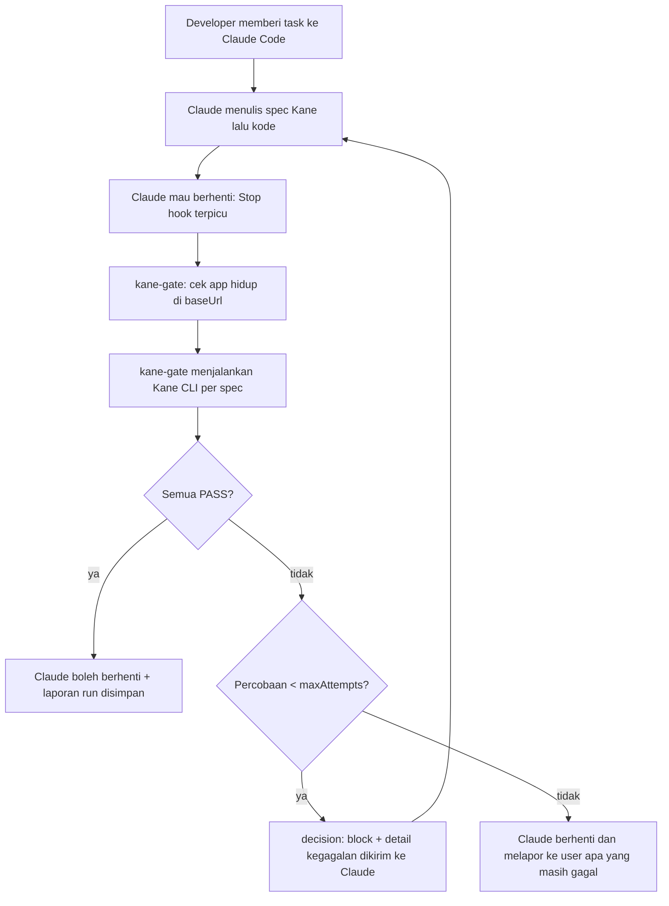

# PRD: kane-gate × ReconPilot

Tanggal: 17 Nov 2026 · Status: Draft v1 · Target: [Kane CLI Hackathon](https://www.kaneclihack.sh/)

## 1. Ringkasan & tujuan

Kita membangun **kane-gate**, gerbang verifikasi yang membuat AI coding agent tidak boleh bilang "selesai" sebelum Kane CLI membuktikan aplikasinya jalan di browser sungguhan. Untuk demo, kane-gate dipasang di **ReconPilot**, aplikasi rekonsiliasi transaksi dari dua file CSV yang sengaja diberi bug realistis.

Target: juara 1. Submit sebelum **19 Nov 2026, 23:59 IST (20 Nov, 01:29 WIB)**.

| Kriteria juri (25% masing-masing) | Cara kita menang |
| --- | --- |
| Ships | ReconPilot + kane-gate jalan end-to-end, dari prompt sampai PASS |
| Verified | Kane menangkap 3 bug nyata yang lolos dari agent |
| Closed loop | Hasil gagal dari Kane otomatis jadi prompt balik ke agent, dan agent tidak bisa berhenti sampai PASS |
| Craft | Pasang dengan satu perintah `npx kane-gate init`, plus laporan run yang rapi |

Tiga syarat lulus/gagal juri (wajib semua): aplikasinya jalan end-to-end, Kane menangkap atau membuktikan sesuatu, dan agent dengan Kane saling berkomunikasi.

## 2. Masalah & pengguna

AI coding agent sering bilang "done" padahal fiturnya rusak di browser. Unit test lolos, tapi alur nyata yang dilihat user gagal. Developer baru tahu setelah mencoba sendiri, lalu harus menjelaskan ulang bug-nya ke agent.

- **Pengguna utama:** developer yang memakai Claude Code (menyusul Cursor, Codex, dan lainnya) untuk membangun aplikasi web.
- **Job to be done:** "Saat agent bilang selesai, saya mau bukti bahwa alur utama aplikasi benar-benar jalan. Kalau tidak jalan, agent yang memperbaikinya sendiri."
- **Pengguna dalam cerita demo:** tim finance yang mencocokkan mutasi bank dengan catatan ERP. Bug kecil di parsing tanggal atau nominal bisa membuat ratusan transaksi salah ditandai, dan bug seperti ini yang sering lolos dari agent.

## 3. Alur utama (closed loop)



1. Developer memberi task, misalnya "tambahkan dukungan format nominal Indonesia".
2. Sesuai aturan di `CLAUDE.md`, Claude menulis atau memperbarui spec di `.kane/specs/` lalu menulis kode.
3. Saat Claude selesai, **Stop hook** Claude Code memanggil `kane-gate hook`.
4. kane-gate memastikan app hidup, lalu menjalankan setiap spec lewat Kane CLI.
5. Jika ada FAIL, kane-gate membalas `{"decision":"block","reason":"<detail kegagalan>"}`. Claude membaca alasan itu sebagai instruksi baru dan memperbaiki kode. Lalu kembali ke langkah 3.
6. Jika semua PASS, Claude boleh berhenti dan run dicatat di `.kane/runs/`.

## 4. Komponen 1: kane-gate

Paket npm (Node + TypeScript) yang menghubungkan Claude Code dengan Kane CLI lewat Stop hook.

### Perintah CLI

| Perintah | Fungsi | Prioritas |
| --- | --- | --- |
| `npx kane-gate init` | Membuat `kane-gate.config.json` dan folder `.kane/specs/`, memasang Stop hook di `.claude/settings.json`, menambah aturan ke `CLAUDE.md` | P0 |
| `kane-gate run` | Menjalankan semua spec lewat Kane CLI dan mencetak PASS/FAIL per spec | P0 |
| `kane-gate hook` | Mode hook: membaca JSON dari stdin, menjalankan spec, memblokir Claude bila ada FAIL | P0 |
| `kane-gate report` | Membuat laporan HTML riwayat run (iterasi, spec, hasil, bukti dari Kane) | P1 |
| `kane-gate run --changed` | Hanya menjalankan spec yang relevan dengan file yang berubah (`git diff`) | P2 |

### Requirement fungsional

1. **Spec dalam bahasa Inggris biasa.** Satu file `.kane/specs/<nama>.md` per alur, berisi URL awal, langkah, dan hasil yang diharapkan.
2. **Agent menulis spec sendiri.** Aturan di `CLAUDE.md`: setiap fitur baru wajib disertai spec Kane, dan spec ditulis sebelum kode.
3. **Menunggu app siap.** Sebelum tes, kane-gate memastikan dev server merespons di `baseUrl` (cek HTTP, timeout 60 detik).
4. **Umpan balik yang bisa ditindaklanjuti.** Pesan blokir berisi nama spec yang gagal, langkah yang gagal, hasil yang diharapkan dibanding yang terlihat, dan link bukti (screenshot/video) bila Kane menyediakannya.
5. **Batas loop.** Maksimal 3 percobaan per sesi (`maxAttempts`). Setelah itu Claude dibiarkan berhenti dan diminta melapor ke user apa yang masih gagal. Flag `stop_hook_active` dari Claude Code dipakai untuk mencegah loop tanpa akhir.
6. **Log setiap run** di `.kane/runs/<timestamp>.json`, untuk laporan dan video demo.

### Contoh spec

```md
# Upload & rekonsiliasi dasar
Start: http://localhost:5173
1. Upload `samples/bank.csv` sebagai Sumber A dan `samples/erp.csv` sebagai Sumber B
2. Klik "Reconcile"
Expected:
- Kartu ringkasan menunjukkan Matched = 42, Amount mismatch = 3, Unmatched A = 2, Unmatched B = 1, Duplicate = 2
- Baris dengan referensi "INV-1007" berstatus "Amount mismatch" dengan selisih Rp 50.000
```

### Konfigurasi `kane-gate.config.json`

```json
{
  "baseUrl": "http://localhost:5173",
  "startCommand": "npm run dev",
  "specsDir": ".kane/specs",
  "maxAttempts": 3,
  "target": "browser"
}
```

## 5. Komponen 2: ReconPilot (aplikasi demo)

Aplikasi web satu halaman: Vite + React + TypeScript. Logika matching berupa fungsi TypeScript murni yang berjalan di browser, jadi tidak perlu backend.

### Fitur (P0)

1. Upload dua file CSV: Sumber A (mutasi bank) dan Sumber B (catatan ERP). Ada tombol "Load sample data".
2. Pemetaan kolom otomatis: tanggal, referensi, deskripsi, nominal.
3. Tombol **Reconcile**, lalu tampil kartu ringkasan per status.
4. Tabel hasil dengan filter per status dan selisih nominal.
5. Export hasil ke CSV.

### Aturan matching

| Status | Aturan |
| --- | --- |
| Matched | Referensi sama (setelah dinormalisasi) dan nominal sama (toleransi Rp 0,01) |
| Amount mismatch | Referensi sama, nominal beda |
| Unmatched A / Unmatched B | Referensi hanya ada di satu sumber |
| Duplicate | Referensi muncul lebih dari sekali di sumber yang sama |

Normalisasi referensi: trim spasi, huruf besar semua. Tanggal ±3 hari dipakai sebagai pemecah seri bila referensi kosong (P1).

### Bug yang ditanam untuk demo

Ketiga bug ini disengaja: unit test sederhana lolos, tapi hasil di layar salah dan Kane bisa menangkapnya.

| # | Bug | Gejala di layar |
| --- | --- | --- |
| 1 | Nominal format Indonesia `1.250.000,00` dibaca sebagai `1.25` | Banyak transaksi jadi "Amount mismatch" palsu |
| 2 | Referensi tidak di-trim (`"INV-1001 "` ≠ `"INV-1001"`) | Transaksi yang seharusnya cocok jadi Unmatched |
| 3 | Tanggal `03/11/2026` dibaca sebagai 11 Maret, bukan 3 November | Tanggal di tabel salah dan urutannya kacau |

## 6. Skenario video demo (3–5 menit)

1. **0:00 Hook (20 detik):** "Agent kamu bilang done. Yakin?" Tampilkan Claude bilang selesai padahal ReconPilot salah hitung.
2. **0:20 Masalah (30 detik):** Rekonsiliasi finance, dan satu bug parsing berarti ratusan transaksi salah.
3. **0:50 Install (30 detik):** `npx kane-gate init`. Tunjukkan file yang dibuat dan hook yang terpasang.
4. **1:20 Loop langsung (2 menit):** Beri task ke Claude. Claude bilang selesai, kane-gate jalan, Kane membuka browser dan FAIL ("Matched seharusnya 42, terlihat 17"). Claude menerima alasan itu, memperbaiki parsing, dan Kane jalan lagi sampai PASS.
5. **3:20 Bukti (40 detik):** Laporan `kane-gate report`: 3 bug ditangkap, jumlah iterasi, durasi.
6. **4:00 Penutup (20 detik):** Satu perintah install, kompatibel dengan agent lain. Link repo.

Siapkan rekaman cadangan dari run yang sukses, karena juri meminta fallback untuk layanan pihak ketiga.

## 7. Pemetaan ke syarat submission

| Syarat | Rencana |
| --- | --- |
| Repo GitHub publik, dibuat ≥ 12 Nov | Repo baru `reconpilot` (monorepo: `packages/kane-gate`, `apps/reconpilot`) |
| About your app | README: apa ini, agent yang dipakai (Claude Code), peran Kane |
| Video demo 3–5 menit di YouTube | Mengikuti skenario di bagian 6 |
| Live URL (opsional) | ReconPilot di Vercel |
| Minimal 2 post publik | X + LinkedIn (bonus: Reddit r/ClaudeAI, Show HN) |
| Akses juri | Tanpa login; rekaman run sebagai cadangan |
| Akun TestMu AI | Daftar dengan email yang sama dengan pendaftaran event, pakai 10.000 kredit gratis |

## 8. Non-goals, risiko, asumsi

**Non-goals:** dukungan iOS/Android, backend atau database, autentikasi, hook untuk agent selain Claude Code (cukup disebut di README sebagai roadmap).

| Risiko / asumsi | Dampak | Mitigasi |
| --- | --- | --- |
| Format output Kane CLI (exit code, JSON, link bukti) belum dicek | Parsing hasil bisa salah | Hari pertama: jalankan quickstart Kane dan catat formatnya |
| Kane mungkin jalan di cloud dan tidak bisa membuka `localhost` | Tes tidak bisa jalan | Cek docs untuk tunnel; cadangannya deploy preview ke Vercel atau pakai `cloudflared` |
| Satu run Kane lambat (menit) | Loop terasa lama di video | Spec dibuat sedikit dan fokus; percepat bagian video yang menunggu |
| Kredit TestMu habis | Tidak bisa tes | Minta kredit tambahan di Slack event |
| Claude memperbaiki dengan cara curang (mengubah spec, bukan kode) | Loop tidak jujur | Aturan di `CLAUDE.md` + kane-gate memperingatkan bila spec berubah saat loop perbaikan |

## 9. Timeline & definisi selesai

**Selasa 17 Nov**
- [ ] Daftar TestMu AI, install `@testmuai/kane-cli`, jalankan quickstart, catat format output
- [ ] Inisialisasi repo + monorepo
- [ ] ReconPilot: upload, matching, ringkasan, tabel, sample data
- [ ] Tanam 3 bug + spec Kane untuk alur utama

**Rabu 18 Nov**
- [ ] kane-gate: `init`, `run`, `hook` (P0)
- [ ] Uji loop end-to-end dengan Claude Code minimal 3 kali
- [ ] `kane-gate report` (P1)
- [ ] Deploy ReconPilot ke Vercel

**Kamis 19 Nov**
- [ ] README + GIF demo
- [ ] Rekam video dan upload ke YouTube
- [ ] Post di X + LinkedIn
- [ ] Submit sebelum 23:59 IST

**Definisi selesai:** dari repo bersih, `npx kane-gate init` lalu satu task ke Claude Code menghasilkan minimal satu FAIL dari Kane, perbaikan otomatis oleh Claude, dan PASS, tanpa campur tangan manusia.
